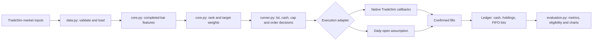

# TradeSim SET50 research architecture

The research package follows one data path from validated daily history to features, portfolio targets, feasible orders, confirmed fills, and evaluation. The same feature and portfolio logic serves both the TradeSim tick adapter and a clearly labeled daily-open research adapter.



## Responsibilities

- **Data loading and validation — `data.py`:** loads actual TradeSim history, checks dates/prices/volume and records file identities. It does not fill missing observations with future values.
- **Features — `core.py`:** computes returns, relative strength, volatility and Wilder RSI from completed daily closes before the decision date. At least 21 prior closes are required by the starting 20-session aligned feature window.
- **Portfolio decisions — `select_targets()`:** ranks eligible names deterministically and converts scores to constrained weights. RSI oversold ranks lowest RSI first and retains only values below 30.
- **Order sizing and execution — `ResearchState` in `runner.py`:** freezes target quantities from the prior close, rounds down to 100-share lots, enforces cash after fees and per-name caps, and routes actions to either native TradeSim or the daily-open assumption.
- **Accounting — `Ledger` in `core.py`:** only confirmed fills change cash or shares. Pending buys reserve cash; cancellations and rejections release only unfilled commitments. FIFO lots carry transaction costs.
- **Evaluation — `evaluation.py`:** aligns the SET50 benchmark, calculates returns, drawdown, exposure, turnover, FIFO statistics and provisional rule checks, then writes tables and charts.

## Timing and limitations

Each daily signal uses data through the previous completed session's close, labeled 09:30 Bangkok time in the research records. Earliest modeled order time is 10:00. Native callbacks cannot use the current daily close. Symbols missing a valid aligned feature row are excluded. During execution, missing symbols cannot trade and stale held assets retain the last observed mark, which is recorded.

The supplied native engine uses Market orders, not the competition's specified Limit or Market-to-Limit IOC orders; it does not produce partial fills. The daily adapter assumes next-open liquidity. Neither path establishes official competition eligibility. The permitted universe is current rather than point-in-time historical membership, so survivorship bias remains.

## Suggested repository layout

```text
try_al_tr/
  docs/                 architecture, roadmap, research findings
  notebooks/            executed comparison notebook
  research_set50_baseline/  reusable Python package and small config
  results/              compact comparison tables and charts only
```

Do not commit the original market dataset, the TradeSim engine, virtual environments, copied plotting packages, raw tick logs, or the full per-order experiment directories. Reproduction requires the TradeSim project and data separately, as explained in the research README.
